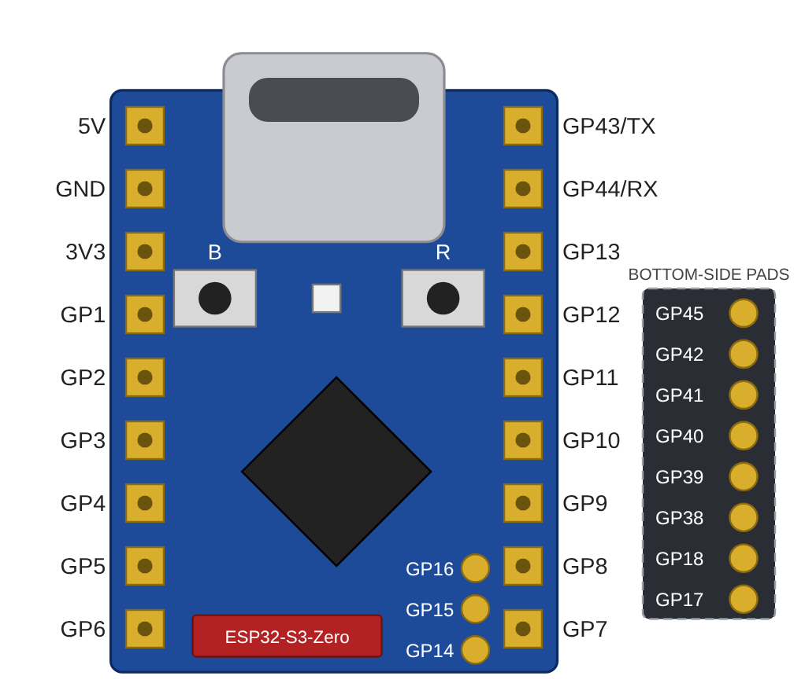
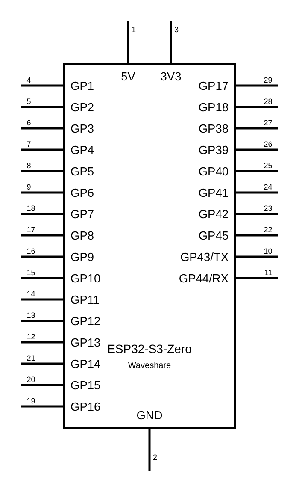
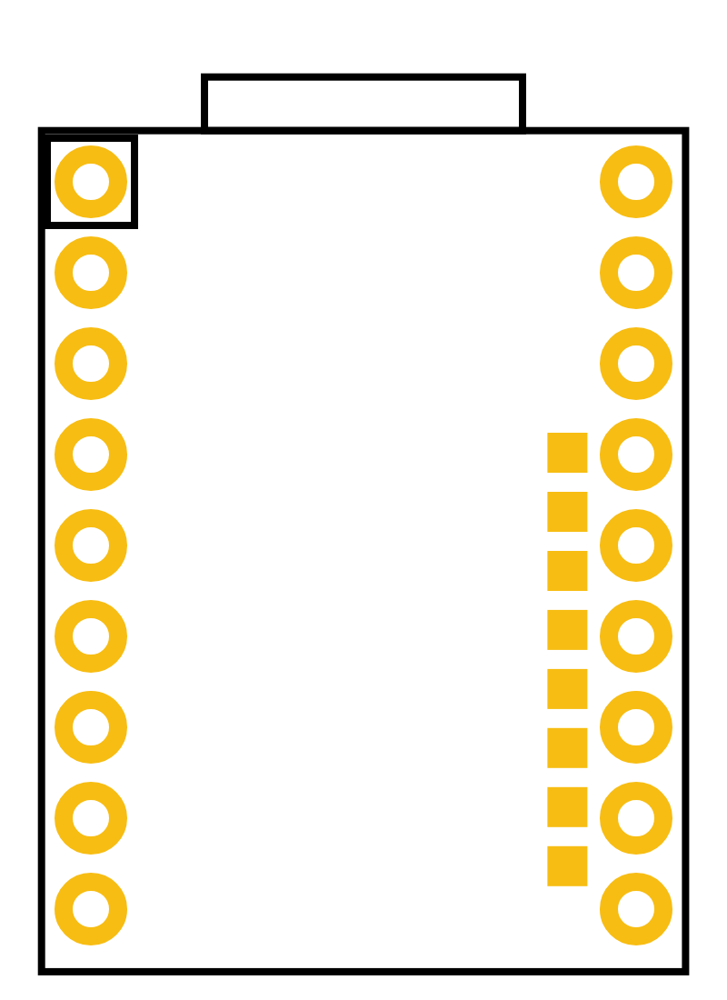

# Waveshare ESP32-S3-Zero: Fritzing part

A custom [Fritzing](https://fritzing.org) part for the [Waveshare ESP32-S3-Zero](https://www.waveshare.com/wiki/ESP32-S3-Zero) mini development board (ESP32-S3FH4R2, 4 MB flash, 2 MB PSRAM, USB-C, 23.5 x 18 mm).

| Breadboard | Schematic | PCB |
|---|---|---|
|  |  |  |

## Install

1. Download [`waveshare_esp32_s3_zero.fzpz`](waveshare_esp32_s3_zero.fzpz).
2. In Fritzing: **File -> Import...** and select the file.
3. The part appears in the **My Parts** bin (search "ESP32-S3-Zero").

## Pins (29 connectors)

Pinout transcribed from Waveshare's official pinout diagram. Numbers are the part's pin numbers (connector index + 1), not GPIO numbers.

| Group | Pins (top to bottom, USB-C at the top) |
|---|---|
| Left header | 5V, GND, 3V3, GP1, GP2, GP3, GP4, GP5, GP6 |
| Right header | GP43/TX, GP44/RX, GP13, GP12, GP11, GP10, GP9, GP8, GP7 |
| Top-face pads | GP16, GP15, GP14 |
| Bottom-face pads | GP45, GP42, GP41, GP40, GP39, GP38, GP18, GP17 |

Not broken out, so not in the part: GPIO0 (BOOT button) and GPIO21 (on-board WS2812 LED). GPIO33-37 are used internally for PSRAM.

Header pins sit on the 0.1 in grid with 0.6 in (15.24 mm) row spacing.

## Known limitations

- **PCB view** has the 18 header pads and the 8 bottom pads. GP14, GP15 and GP16 are omitted there because they would overlap the bottom pads on the same copper layer. They work in breadboard and schematic views.
- **Estimated geometry:** the positions of the interior pads, their 1.65 mm spacing and the USB-C overhang were measured from Waveshare's product images, not a dimension drawing. Verify against Waveshare's 2D files before relying on the footprint for a manufactured board.
- Labels in the SVGs use live text (Droid Sans) rather than outlines.

## Repository layout

```
waveshare_esp32_s3_zero.fzpz   importable part
src/                           .fzp and SVGs (breadboard, schematic, pcb, icon)
images/                        previews
tools/gen_part.py              generator: rebuilds src/ and the .fzpz from one pin list
```

Rebuild with `python3 tools/gen_part.py <output-dir>`.

## License

[CC BY-SA 4.0](https://creativecommons.org/licenses/by-sa/4.0/), the same license as the Fritzing core parts. See `LICENSE`. Not affiliated with or endorsed by Waveshare.
